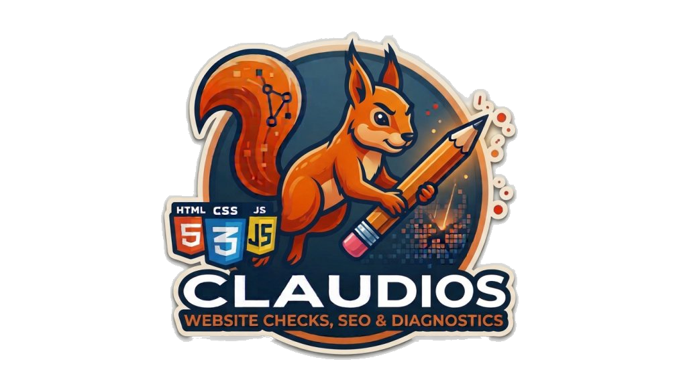

  

# Claudios – Website Checks, SEO & Diagnostics

English version: [README.md](README.md)

Freeware für Windows (Python): prüft eine einzelne Website auf sauberes HTML, CSS und JavaScript (W3C-Referenzen), Sicherheit, Datenschutz, SEO und Barrierefreiheit. Jede Prüfung erklärt, *warum* sie wichtig ist.

*vipecoded with Claude (Anthropic) by fuhfux with love ❤️*

## Stand

Frühe Version. Über 400 automatische Tests laufen gegen **simulierte** Websites, DNS-Antworten und Werkzeugausgaben. Windows-Build und Installer entstehen in der CI, das installierte Programm ist aber noch nicht auf echten Rechnern geprüft. Das Verhalten in der Praxis (echte Websites, die echten Werkzeuge, die Google-Anmeldung) wird noch geprüft. Ergebnisse sind technische Indizien, keine Zertifizierung und keine Rechtsberatung.

## Was geprüft wird

- **HTML / CSS / JS:** Dokumentstruktur, doppelte IDs, Überschriften, Landmarks, Formulare, W3C Nu Html Checker, W3C CSS Validator, ESLint (Security-Plugin), Stylelint, retire.js, riskante Muster, Subresource Integrity, Inline-Handler
- **Sicherheit:** CSP, HSTS, Clickjacking, Referrer-Policy, Permissions-Policy, COOP/COEP/CORP, Cookies, CORS, Cache-Control, Mixed Content, Geheimnisse im Quelltext, `security.txt`, TLS-Zertifikat, TLS-Protokolle und Cipher (sslyze)
- **DNS und Mail:** SPF, DKIM, DMARC, CAA, MTA-STS (auch die Richtliniendatei), TLS-RPT, DNSSEC, Subdomain-Takeover (DNS und Fehlerseiten-Fingerprints)
- **SEO:** Titel, Beschreibung, Canonical, robots.txt (im Detail), hreflang und Sprachangaben, Open Graph, strukturierte Daten (in der Tiefe), Sitemap, Soft-404, Links, Komprimierung, Caching, dünne und doppelte Inhalte, URL-Struktur, Klicktiefe, Favicon, KI-Crawler, `llms.txt`, Vertrauenssignale, lokales SEO, Online-Shops
- **Datenschutz:** Links auf Impressum und Datenschutzerklärung, externe Dienste, Cookies beim ersten Aufruf, Einwilligungslösung und Qualität des Banners
- **Browser (Chromium über Playwright):** Konsolenfehler, Barrierefreiheit mit axe-core (WCAG 2.2), responsive Darstellung, Ladeleistung, nachgeladene Dienste; optional Vergleich mit Firefox und WebKit (Profil Tief)
- **Stufe 2 (nur verifizierte Domains):** frei erreichbare Dateien (feste Pfadliste), TLS-Angriffstests, passive Analyse mit OWASP ZAP, Search-Console-Daten
- **Optionale Online-Dienste (alle standardmäßig aus):** Domainablauf (RDAP), Google Safe Browsing (eigener Schlüssel), PageSpeed Insights; lokale Screenshots

Berichte: ZIP mit Prompt für Claude (allgemein oder mit Schwerpunkt Sicherheit, SEO, Datenschutz, Barrierefreiheit oder Code), CSV, Excel, PDF und ein optionaler Vergleich mit früheren Scans (wird nur gespeichert, wenn du es einschaltest).

Das Handbuch im Programm nennt zu jeder Prüfung ein „Warum?“, die Technik-Doku zeigt die genauen Regeln und den Code.

## Sicherheit durch Design

- Nur HTTPS; Zertifikatsfehler brechen den Scan mit klarer Begründung ab
- Höchstens 6 Crawl-Ebenen; 25 Seiten (Selbstauskunft) bzw. 100 Seiten (Google-verifiziert); gedrosselt
- Eine Domain pro Scan; Tages- und Stundenlimits, Abkühlzeit zwischen Scans und ein manipulationssicheres Scan-Protokoll
- Keine Kommandozeile, API, Massenabfrage, Plugins oder Telemetrie
- Passwörter, Cookie-Werte und Tokens werden nie gespeichert oder exportiert
- Aktive Prüfungen nur für verifizierte Domains (Stufe 2)
- Prüfungen, die nicht laufen konnten, stehen als „nicht ausgeführt“ im Bericht, nie als „bestanden“

Diese Schutzmaßnahmen verhindern versehentlichen Missbrauch. Wer den Quellcode verändert, wird davon nicht aufgehalten. Nutze Claudios nur für eigene oder ausdrücklich freigegebene Websites. Einzelheiten: [docs/ABUSE_PROTECTION.de.md](docs/ABUSE_PROTECTION.de.md).

## Entwicklung

    py -3.12 -m venv .venv
    .venv\Scripts\activate
    pip install -e ".[dev,gui]"
    pytest

Programm starten: `python -m claudios`. Einen Windows-Installer baut der GitHub-Workflow „Windows-Build und Installer“ (Installation für den aktuellen Benutzer, ohne Admin-Rechte).

## Mehr

[FAQ](FAQ.de.md) · [Sicherheitsrichtlinie](SECURITY.de.md) · [Bedrohungsmodell](THREAT_MODEL.de.md) · [Mitwirken](CONTRIBUTING.de.md) · [Externe Dienste](docs/EXTERNAL_SERVICES.de.md) · [Google einrichten](docs/GOOGLE_SETUP.de.md) · [Lizenzen Dritter](THIRD_PARTY_NOTICES.de.md) · [Änderungsprotokoll](CHANGELOG.de.md)

Lizenz: MIT für den Code. Das Logo ist ausgenommen (siehe `assets/ASSETS.de.md`). Freeware, keine Gewährleistung und Haftung, soweit gesetzlich zulässig.
