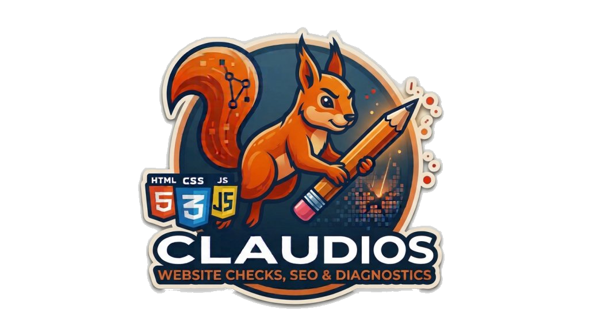

  

# Claudios – Website Checks, SEO & Diagnostics

Freeware Windows tool (Python) that checks a website for clean HTML, CSS and JavaScript (W3C references),
security, privacy and SEO. Every check explains *why* it matters.

*vipecoded with Claude (Anthropic) by fuhfux with love ❤️*

Deutsch: [README.de.md](README.de.md)

## Status

Early version. The automated tests (about 125) run against **simulated** websites, DNS answers and tool outputs.
Real-world behaviour (live sites, the real W3C tools, the installer) is still being verified. Treat results as
technical indications, not as a certification and not as legal advice.

## What it checks

- **HTML / CSS / JS:** document structure, W3C Nu Html Checker, W3C CSS Validator, ESLint (security plugin),
  Stylelint, retire.js, risky patterns, Subresource Integrity, inline handlers
- **Security:** CSP, HSTS, clickjacking, referrer policy, cookies, CORS, cache control, mixed content,
  secrets in source, TLS certificate, TLS protocols and ciphers (sslyze)
- **DNS and mail:** SPF, DKIM, DMARC, CAA, MTA-STS, TLS-RPT, DNSSEC, subdomain-takeover hints
- **SEO:** title, description, canonical, robots, hreflang, Open Graph, structured data, sitemap, soft 404, links
- **Privacy:** legal notice and privacy policy links, third-party services, cookies on first load, consent solution
- **Others:** ads.txt, CMS detection, e-mail addresses in plain text

The manual inside the program lists every check with a "Why?" section; the technical documentation shows the
exact rules and code.

## Safety by design

- HTTPS only; certificate errors abort the scan with a clear reason
- At most 6 crawl levels; 25 pages (self-declaration) or 100 pages (Google-verified); throttled
- One domain per scan; no command line, API, batch mode, plugins or telemetry
- Passwords, cookie values and tokens are never stored or exported
- Active checks only for domains you verified (level 2)
- Checks that could not run are shown as "not executed", never as "passed"

These protections prevent accidental misuse. They cannot stop someone who modifies the source code.
Use Claudios only on websites you own or are authorised to test.

## Development

    py -3.12 -m venv .venv
    .venv\Scripts\activate
    pip install -e ".[dev,gui]"
    pytest

Start the program: `python -m claudios`. A Windows installer is built by the GitHub workflow
"Windows-Build und Installer" (installs for the current user, no admin rights).

## More

[FAQ](FAQ.md) · [Security policy](SECURITY.md) · [Contributing](CONTRIBUTING.md) ·
[Third-party notices](THIRD_PARTY_NOTICES.md) · [Changelog](CHANGELOG.md)

License: MIT for the code. The logo is excluded (see `assets/ASSETS.md`). Freeware, no warranty or liability as far
as legally permitted.
