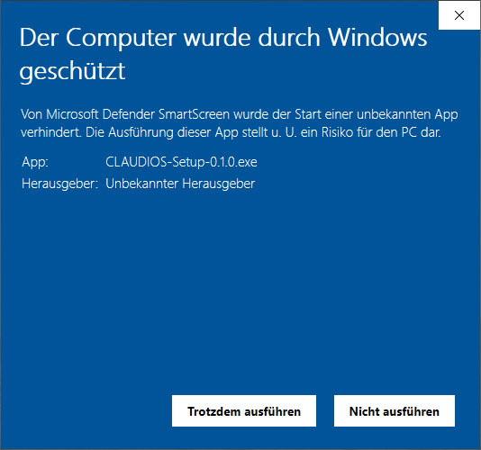

<p align="center">
  
</p>

# CLAUDIOS – Website Checks, SEO & Diagnostics
Deutsche Fassung: [README.de.md](README.de.md)

Freeware tool for Windows and macOS (Python) that checks a single website for clean HTML, CSS and JavaScript (W3C references), security, privacy, SEO and accessibility. Every check explains *why* it matters.

*vibecoded with Claude (Anthropic) by conejito-vipe with love ❤️*

## Status
Early version. More than 400 automated tests run against **simulated** websites, DNS answers and tool outputs. The Windows build and installer are produced in CI and have had a first test on Windows 10. Real-world behaviour (live sites, the real tools, the Google sign-in) is still being verified. Treat results as technical indications, not as a certification and not as legal advice.

## License & Usage
CLAUDIOS is made publicly available for testing and ongoing development. See the [LICENSE](./LICENSE) file for the full terms; the German version is binding.

- **Free use:** individuals (non-commercial) and non-profit organizations and associations (for non-profit purposes), each on their own systems.
- **No commercial use without permission:** companies, self-employed people, agencies and public authorities must contact me in advance via my GitHub profile ([@conejito-vipe](https://github.com/conejito-vipe)) to request permission or a license.
- **No modification, no redistribution:** the software must not be modified or passed on to third parties, not even unchanged. The source code is there to be read and inspected.
- **Exclusions:** political parties, as well as associations or groups that are classified as a right-wing extremist effort by the Office for the Protection of the Constitution (federal or state) or that are banned, are excluded from using this software (details in the [LICENSE](./LICENSE)).

Without any warranty or guarantee of success.

## What it checks
- **HTML / CSS / JS:** document structure, duplicate IDs, headings, landmarks, forms, W3C Nu Html Checker, W3C CSS Validator, ESLint (security plugin), Stylelint, retire.js, risky patterns, Subresource Integrity, inline handlers
- **Security:** CSP, HSTS, clickjacking, referrer policy, permissions policy, COOP/COEP/CORP, cookies, CORS, cache control, mixed content, secrets in source, `security.txt`, TLS certificate, TLS protocols and ciphers (sslyze)
- **DNS and mail:** SPF, DKIM, DMARC, CAA, MTA-STS (including the policy file), TLS-RPT, DNSSEC, subdomain takeover (DNS and error-page fingerprints)
- **SEO:** title, description, canonical, robots.txt (in depth), hreflang and language signals, Open Graph, structured data (in depth), sitemap, soft 404, links, compression, caching, thin and duplicate content, URL structure, click depth, favicon, AI crawlers, `llms.txt`, trust signals, local SEO, online shops
- **Privacy:** links to legal notice and privacy policy, third-party services, cookies on first load, consent solution and banner quality
- **Browser (Chromium via Playwright):** console errors, accessibility with axe-core (WCAG 2.2), responsive layout, loading performance, services loaded later; optional Firefox and WebKit comparison (deep profile)
- **Level 2 (verified domains only):** exposed files (fixed path list), TLS attack tests, passive analysis with OWASP ZAP, Search Console data
- **Optional online services (all off by default, expert settings on the scan page):** domain expiry (RDAP), Google Safe Browsing (own key), PageSpeed Insights; local screenshots

Reports: ZIP with a prompt for Claude (general or focused on security, SEO, privacy, accessibility or code), CSV, Excel, PDF and an optional comparison with earlier scans (stored only if you switch it on).

The manual inside the program lists every check with a "Why?" section; the technical documentation shows the exact rules and code.

## macOS
Download `CLAUDIOS_v<version>_Mac.zip` from the latest release (Apple silicon, macOS 12 or newer), unzip it and move `CLAUDIOS.app` to the Applications folder. The app is not notarized (that needs a paid Apple developer account). On first start macOS says it cannot verify the app: right-click `CLAUDIOS.app`, choose **Open**, then **Open** again (or allow it under System Settings > Privacy & Security). Check the file against `SHA256SUMS.txt` with `shasum -a 256`.

What works on the Mac: all built-in checks (HTML, headers, SEO, privacy, DNS, mail security, links, accessibility, Google Search Console with the Keychain), reports and exports. The extra tools that are downloaded on Windows (Java validators, ESLint, Stylelint, retire.js, OWASP ZAP, sslyze, Playwright browsers) are **not yet available on the Mac**; the matching checks are reported as not executed. The Mac app does not update itself: when a new version exists it opens the release page. Data lives in `~/Library/Application Support/CLAUDIOS`; to uninstall use the menu entry (removes data and keys), then move the app to the Trash.

## Windows SmartScreen
The installer is not code-signed (certificates cost money). Windows SmartScreen therefore shows "Windows protected your PC" and lists the publisher as "Unknown publisher". To install anyway:



1. Compare the SHA256 checksum shown in the build log with the downloaded file.
2. In the SmartScreen window click **More info**, then **Run anyway**.

The publisher name in the installer and in the list of installed apps is **GitHub - conejito-vipe**. A name there does not remove the SmartScreen warning, only a code-signing certificate does.

## Safety by design
- HTTPS only; certificate errors abort the scan with a clear reason
- At most 6 crawl levels; up to 250 pages; throttled
- One domain per scan; daily and hourly limits, a cool-down between scans and a tamper-evident scan log
- No command line, API, batch mode, plugins or telemetry
- Passwords, cookie values and tokens are never stored or exported
- Active checks only for domains you verified (level 2)
- Checks that could not run are shown as "not executed", never as "passed"

These protections prevent accidental misuse. They cannot technically stop someone who changes the source code; the license forbids that. Use CLAUDIOS only on websites you own or are authorised to test. Details: [docs/ABUSE_PROTECTION.md](docs/ABUSE_PROTECTION.md).

## Building from source (for your own use, unmodified)
```
py -3.12 -m venv .venv
.venv\Scripts\activate
pip install -e ".[dev,gui]"
pytest
```
Start the program: `python -m claudios`. A Windows installer is built by the GitHub workflow "Windows-Build und Installer" (installs for the current user, no admin rights). Passing on the installer or the source code is not allowed.

## More
[FAQ](FAQ.md) · [Security policy](SECURITY.md) · [Threat model](THREAT_MODEL.md) · [Feedback](CONTRIBUTING.md) · [External services](docs/EXTERNAL_SERVICES.md) · [Google setup](docs/GOOGLE_SETUP.md) · [Third-party notices](THIRD_PARTY_NOTICES.md) · [Changelog](CHANGELOG.md) · [License](LICENSE)

The logo is part of the work and may only be used together with CLAUDIOS (see `assets/ASSETS.md`). Freeware, no warranty or liability as far as legally permitted.
