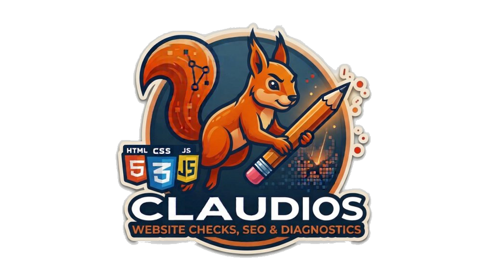

  

# Claudios – Website Checks, SEO & Diagnostics

Deutsche Fassung: [README.de.md](README.de.md)

Freeware Windows tool (Python) that checks a single website for clean HTML, CSS and JavaScript (W3C references), security, privacy, SEO and accessibility. Every check explains *why* it matters.

*vipecoded with Claude (Anthropic) by fuhfux with love ❤️*

## Status

Early version. More than 400 automated tests run against **simulated** websites, DNS answers and tool outputs. The Windows build and installer are produced in CI, but the installed program has not yet been verified on real machines. Real-world behaviour (live sites, the real tools, the Google sign-in) is still being verified. Treat results as technical indications, not as a certification and not as legal advice.

## What it checks

- **HTML / CSS / JS:** document structure, duplicate IDs, headings, landmarks, forms, W3C Nu Html Checker, W3C CSS Validator, ESLint (security plugin), Stylelint, retire.js, risky patterns, Subresource Integrity, inline handlers
- **Security:** CSP, HSTS, clickjacking, referrer policy, permissions policy, COOP/COEP/CORP, cookies, CORS, cache control, mixed content, secrets in source, `security.txt`, TLS certificate, TLS protocols and ciphers (sslyze)
- **DNS and mail:** SPF, DKIM, DMARC, CAA, MTA-STS (including the policy file), TLS-RPT, DNSSEC, subdomain takeover (DNS and error-page fingerprints)
- **SEO:** title, description, canonical, robots.txt (in depth), hreflang and language signals, Open Graph, structured data (in depth), sitemap, soft 404, links, compression, caching, thin and duplicate content, URL structure, click depth, favicon, AI crawlers, `llms.txt`, trust signals, local SEO, online shops
- **Privacy:** links to legal notice and privacy policy, third-party services, cookies on first load, consent solution and banner quality
- **Browser (Chromium via Playwright):** console errors, accessibility with axe-core (WCAG 2.2), responsive layout, loading performance, services loaded later; optional Firefox and WebKit comparison (deep profile)
- **Level 2 (verified domains only):** exposed files (fixed path list), TLS attack tests, passive analysis with OWASP ZAP, Search Console data
- **Optional online services (all off by default):** domain expiry (RDAP), Google Safe Browsing (own key), PageSpeed Insights; local screenshots

Reports: ZIP with a prompt for Claude (general or focused on security, SEO, privacy, accessibility or code), CSV, Excel, PDF and an optional comparison with earlier scans (stored only if you switch it on).

The manual inside the program lists every check with a "Why?" section; the technical documentation shows the exact rules and code.

## Safety by design

- HTTPS only; certificate errors abort the scan with a clear reason
- At most 6 crawl levels; 25 pages (self-declaration) or 100 pages (Google-verified); throttled
- One domain per scan; daily and hourly limits, a cool-down between scans and a tamper-evident scan log
- No command line, API, batch mode, plugins or telemetry
- Passwords, cookie values and tokens are never stored or exported
- Active checks only for domains you verified (level 2)
- Checks that could not run are shown as "not executed", never as "passed"

These protections prevent accidental misuse. They cannot stop someone who modifies the source code. Use Claudios only on websites you own or are authorised to test. Details: [docs/ABUSE_PROTECTION.md](docs/ABUSE_PROTECTION.md).

## Development

    py -3.12 -m venv .venv
    .venv\Scripts\activate
    pip install -e ".[dev,gui]"
    pytest

Start the program: `python -m claudios`. A Windows installer is built by the GitHub workflow "Windows-Build und Installer" (installs for the current user, no admin rights).

## More

[FAQ](FAQ.md) · [Security policy](SECURITY.md) · [Threat model](THREAT_MODEL.md) · [Contributing](CONTRIBUTING.md) · [External services](docs/EXTERNAL_SERVICES.md) · [Google setup](docs/GOOGLE_SETUP.md) · [Third-party notices](THIRD_PARTY_NOTICES.md) · [Changelog](CHANGELOG.md)

License: MIT for the code. The logo is excluded (see `assets/ASSETS.md`). Freeware, no warranty or liability as far as legally permitted.
